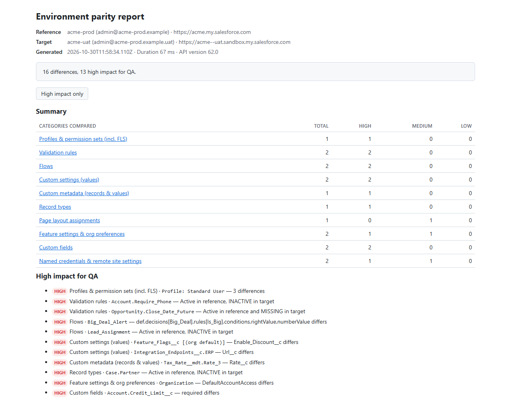
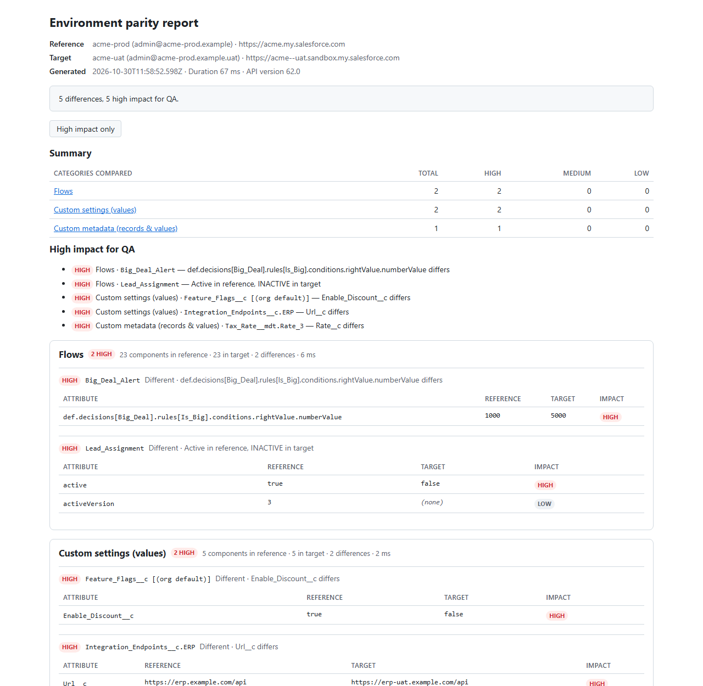
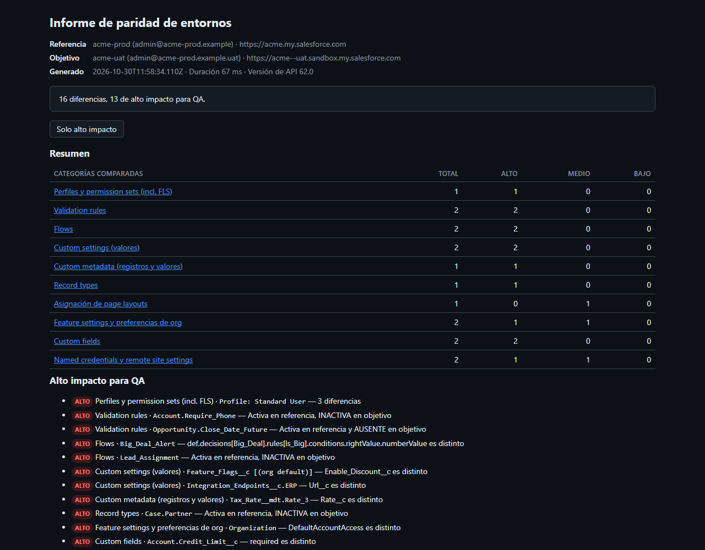

# Salesforce Org Parity – Config Diff for QA

**Why doesn't the bug reproduce in the sandbox?** Usually because the sandbox isn't configured like
production. Org Parity compares the configuration of two Salesforce orgs you're already signed in to
with the Salesforce CLI. It shows what differs and puts first what matters for QA.

**100% local.** No backend, no account, no telemetry. Your metadata and credentials stay on your
computer. The extension only talks to your own orgs, using the session the Salesforce CLI already has.



## What it compares

| Category | What is checked |
|---|---|
| Profiles & permission sets | System permissions, object permissions (CRUD, View/Modify All), **field-level security** |
| Validation rules | Presence, **active / inactive**, formula, error message and field |
| Flows | Presence, **active / inactive**, active version, and the **logic of the active version** (canvas moves are ignored) |
| Custom settings | **Every value**: org default, per profile, per user, list rows |
| Custom metadata | **Every record and field value** |
| Record types | Presence, active, available picklist values |
| Page layout assignments | Which layout each profile and record type gets |
| Feature settings | Account, Case, Security, Sharing, … settings, plus org-wide sharing defaults and locale |
| Custom fields | Presence, type, required/unique, formula, picklist values, length |
| Integrations | Named credentials and remote site settings: endpoints and active flags (secrets are never read) |

Pick only the categories you need: big orgs have a lot of metadata, and fewer categories means a
faster comparison.

## The report

- Grouped by category, with **High / Medium / Low impact for QA**. Examples: a validation rule active
  in production and missing in the sandbox, a custom setting value that differs, or a flow that is
  inactive in the sandbox.
- A **"High impact only"** filter.
- Plain explanations, e.g. *"Active in reference, INACTIVE in target"*.
- **Export to Markdown or HTML** to attach to the bug ticket as an environment parity report.
- English and Spanish.



## Getting started

1. Install the [Salesforce CLI](https://developer.salesforce.com/tools/salesforcecli) and sign in to
   both orgs:
   ```sh
   sf org login web --alias prod
   sf org login web --alias uat --instance-url https://test.salesforce.com
   ```
2. In VS Code, run **Org Parity: Compare two orgs** (Command Palette, or the Org Parity icon in the
   Activity Bar).
3. Choose the **reference** org (e.g. production), then the **target** org (e.g. the sandbox where
   the bug doesn't reproduce), then the categories.
4. Read the report. Export it with the buttons at the top, or with **Org Parity: Export report as
   Markdown / HTML**.

Comparisons only read from your orgs. The extension never deploys or changes anything.

## Privacy & security

- **No servers of ours.** No backend, no analytics, no telemetry, no account.
- **No credentials stored.** The extension asks the Salesforce CLI (`sf org display`, `sf org auth show-access-token`) for the current
  session, keeps it in memory for that one comparison, and never writes it anywhere. The Salesforce
  CLI's own telemetry is turned off for the calls the extension makes.
- **Salesforce domains only.** The session is only ever sent to `*.salesforce.com`, `*.force.com`
  and the other Salesforce domains. The extension refuses any other host and doesn't follow redirects.
- **Nothing persisted.** Results live in memory until you close VS Code. Files are written only when
  you export a report.
- **No secrets read.** Password, token and secret fields of named credentials are dropped before
  comparing.
- The log (**Org Parity: Show log**) contains counts and timings only, never values.

## Settings

| Setting | Default | Description |
|---|---|---|
| `orgParity.cliPath` | *(empty)* | Path to `sf` if it isn't on your PATH (machine-level setting only) |
| `orgParity.language` | `auto` | `auto`, `en` or `es` |
| `orgParity.concurrency` | `4` | Parallel API requests per org |
| `orgParity.requestTimeoutSeconds` | `120` | Timeout per request |
| `orgParity.includeManagedPackages` | `true` | Include namespaced (managed package) components |

## Requirements

- VS Code 1.90 or later
- Salesforce CLI (`sf`, or the older `sfdx`) with both orgs authenticated
- The users you sign in with need the **API Enabled** permission

## Known limitations

- Custom metadata lookups to custom objects can show Ids, which differ between orgs.
- Page layout *contents* (which fields appear on a layout) are not compared yet. Assignments are.
- Very large orgs: *Custom fields* and *Profiles & permission sets* are the slowest categories.

## More Salesforce QA tools

- **[Salesforce Migration Validator – Data Reconciliation for QA](https://marketplace.visualstudio.com/items?itemName=AndrsGarcaRamrez.salesforce-migration-validator-qa)** — validate a data migration into Salesforce (CSV vs org, field by field).

---

## En español

**¿Por qué el bug no se reproduce en el sandbox?** Casi siempre porque no está configurado igual
que producción. Org Parity compara la configuración de dos orgs en las que ya iniciaste sesión con
la Salesforce CLI. Muestra qué difiere y pone primero lo que más afecta a QA: permisos y FLS,
validation rules, flows activos o inactivos, valores de custom settings y custom metadata, record
types, layouts, settings e integraciones.

Todo es **100% local**: sin servidores, sin telemetría y sin guardar credenciales. Puedes exportar el
informe a Markdown o HTML para adjuntarlo al ticket. La interfaz está en español si VS Code está en
español, o si pones `orgParity.language` en `es`.


